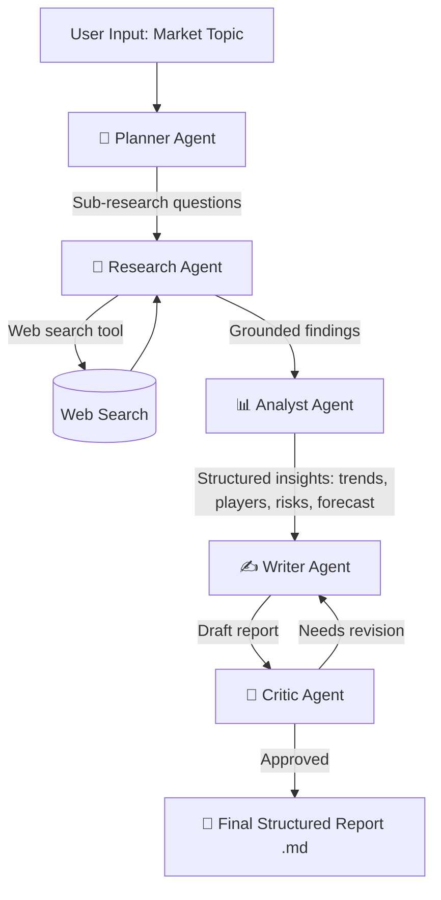

# 🤖 Agentic Market Research System

**Multi-agent AI system where specialized agents collaborate to research a market, analyze findings, and generate a structured research report — end to end, autonomously.**


> Built as a placement/portfolio project to demonstrate multi-agent orchestration, LLM tool-use, and applied GenAI system design.

---

## 📌 Demo Topic

The system ships pre-configured with a sample research run on:

> **"Electric Two-Wheeler Market in India"**

...but it accepts **any market/topic** via a single CLI flag or the Streamlit UI (e.g. "Electric 4-Wheeler Market", "Indian SaaS Market", "Global Plant-Based Meat Market").

A pre-generated example report is included at [`outputs/sample_report_ev_2wheeler.md`](outputs/sample_report_ev_2wheeler.md).

---

## 🧠 Why This Project

Most "AI wrapper" projects call a single LLM once and print the answer. This project instead demonstrates:

- **Multi-agent decomposition** — a single vague goal ("research the EV market") is broken into a pipeline of specialized roles, each with a narrow responsibility, the way a real analyst team would split the work.
- **Tool use** — agents don't just hallucinate facts; a Research Agent calls a live web-search tool and grounds its summaries in retrieved snippets.
- **Iterative self-critique** — a Critic Agent reviews the draft report and can send it back to the Writer Agent for a revision, similar to a reviewer-author loop.
- **Graceful degradation** — the whole pipeline also runs in **mock mode** with zero API keys and no internet, so anyone (including a recruiter with 30 seconds) can clone and run it instantly.

---

## 🏗️ Architecture



### Agent Roster

| Agent | Role | Input | Output |
|---|---|---|---|
| **Planner Agent** | Breaks the market topic into 5–6 focused sub-research questions | Topic string | List of sub-questions |
| **Research Agent** | Runs a web search per sub-question and extracts grounded findings | Sub-question | Findings + cited sources |
| **Analyst Agent** | Synthesizes all findings into structured insights | All findings | Market size, key players, trends, risks, forecast (JSON) |
| **Writer Agent** | Converts structured analysis into a polished report | Analysis JSON | Markdown report |
| **Critic Agent** | Reviews the report for completeness/quality and requests revisions | Draft report | Approval or feedback |

The **Orchestrator** (`src/orchestrator.py`) owns the shared state and drives the agents through this pipeline, including up to 2 writer↔critic revision loops.

---

## 📂 Project Structure

```
agentic-market-research/
├── main.py                  # CLI entry point
├── app.py                   # Streamlit web UI
├── requirements.txt
├── .env.example
├── src/
│   ├── config.py             # Env/config loading
│   ├── llm_client.py         # Anthropic API wrapper (+ offline mock mode)
│   ├── orchestrator.py        # Coordinates the agent pipeline
│   ├── utils.py               # JSON extraction, slugify, etc.
│   ├── agents/
│   │   ├── base_agent.py
│   │   ├── planner_agent.py
│   │   ├── research_agent.py
│   │   ├── analyst_agent.py
│   │   ├── writer_agent.py
│   │   └── critic_agent.py
│   └── tools/
│       └── web_search.py      # DuckDuckGo search tool used by Research Agent
├── outputs/
│   └── sample_report_ev_2wheeler.md
├── tests/
│   └── test_agents.py
└── .github/workflows/ci.yml
```

---

## ⚙️ Tech Stack

- **Python 3.10+**
- **Anthropic Claude API** (`claude-sonnet-5`, configurable) for agent reasoning
- **DuckDuckGo Search** (`ddgs`) — free, no-API-key web search tool
- **Streamlit** — optional interactive UI
- **pytest** + **GitHub Actions** — testing & CI

---

## 🚀 Getting Started

### 1. Clone & install

```bash
git clone https://github.com/pushkar785691-eng/ai-market-research-crew.git
cd ai-market-research-crew
pip install -r requirements.txt
```

### 2. (Optional) Add your Anthropic API key

```bash
cp .env.example .env
# edit .env and add ANTHROPIC_API_KEY=sk-ant-...
```

> **No key? No problem.** Without an API key the system automatically runs in **mock mode**, using deterministic placeholder responses so you can still see the full pipeline execute end-to-end.

### 3. Run from the CLI

```bash
python main.py --topic "Electric Two-Wheeler Market in India"
```

Output is saved to `outputs/<topic-slug>_report.md` (plus a `.json` with the raw agent trace).

### 4. Or run the interactive UI

```bash
streamlit run app.py
```

This shows each agent's progress live, and lets you download the final report.

---

## 🖥️ Example CLI Output

```
[PlannerAgent] Breaking down research topic: Electric Two-Wheeler Market in India
[PlannerAgent] Generated 6 sub-questions
[ResearchAgent] Researching: What is the current market size and growth rate...
[ResearchAgent] Researching: Who are the key players and their market share...
...
[AnalystAgent] Synthesizing findings into structured market analysis
[WriterAgent] Drafting structured research report
[CriticAgent] Reviewing report quality
[CriticAgent] ✅ Report approved
[Orchestrator] Report saved to outputs/electric-two-wheeler-market-in-india_report.md
```

## 🌐 Front-end Demo

The repository also includes a zero-dependency browser demo (`index.html`, `styles.css`, and
`app.js`) that presents the research workflow as a polished dashboard. Open `index.html`
directly or run `python -m http.server 8000` and visit `http://localhost:8000`.

The browser demo uses illustrative data. The Python CLI and Streamlit app run the actual
agent pipeline, with deterministic mock mode available when no API key is configured.

---

## 🧪 Tests

```bash
pytest tests/ -v
```

## 📏 Reproducible Evaluation

The résumé metrics are backed by checked-in, versioned evaluation data rather than hard-coded
display values:

- **90% citation validity** — 9 of 10 manually audited claim/source pairs include supporting
  evidence and a valid source URL; the unresolved citation remains visible.
- **87% section completeness** — 20 of 23 items in the report-quality rubric are present.
- **Under three minutes** — the deterministic offline benchmark executes the complete agent
  orchestration path and records the average runtime across three runs.

Reproduce the results locally:

```bash
python benchmarks/run_benchmark.py --write
pytest tests/ -v
```

See [BENCHMARKS.md](BENCHMARKS.md), [the machine-readable results](benchmarks/results.json),
and the versioned audit inputs in [`benchmarks/`](benchmarks/). The runtime result explicitly
excludes external model and network latency.

---

## 🔮 Future Improvements

- Swap sequential orchestration for a graph-based framework (LangGraph) with parallel research sub-agents
- Add a **Fact-Checker Agent** that cross-verifies claims across multiple sources
- Add PDF/PPTX export of the final report
- Persist agent traces to a vector DB for retrieval across research sessions
- Add citation-level source tracking in the final report

---

## 📜 License

MIT — see [LICENSE](LICENSE).

---

## 🙋 About

Built as a demonstration project for exploring agentic AI system design: task decomposition, tool-augmented reasoning, inter-agent hand-offs, and self-review loops.
